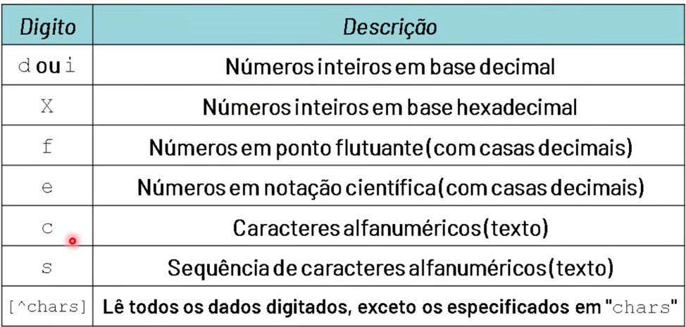
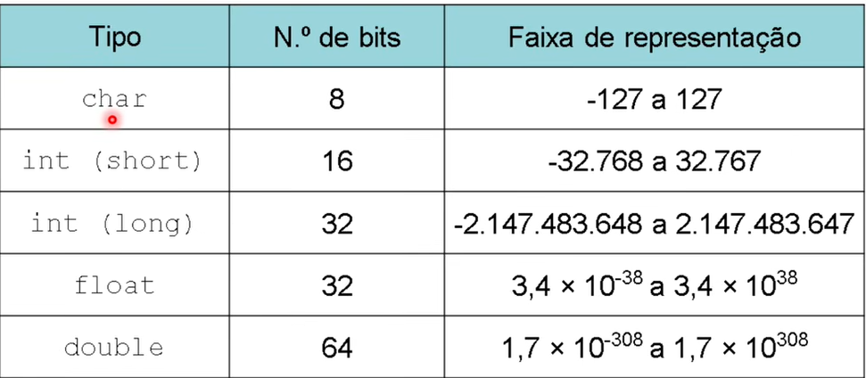
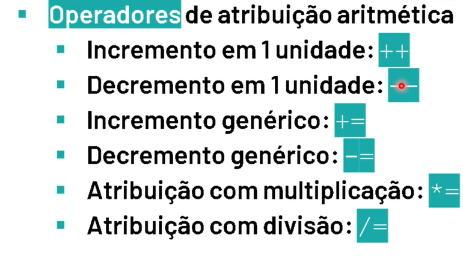

# Curso Logica De Programação Em C

 - Link: [PLAYLIST DO CURSO LOGICA DE PROGRAMACAO EM C](https://www.youtube.com/playlist?list=PLpaKFn4Q4GMOBAeqC1S5_Fna_Y5XaOQS2)

- 2.1 Saida De Dados - Sequencias de Escapes:
  

- 2.2 Entrada De Dados - Formatos de Especificadores:

- 3.1 Variaveis - Tipos de Dados:

- 3.2 Operadores De Atribuição:
  

