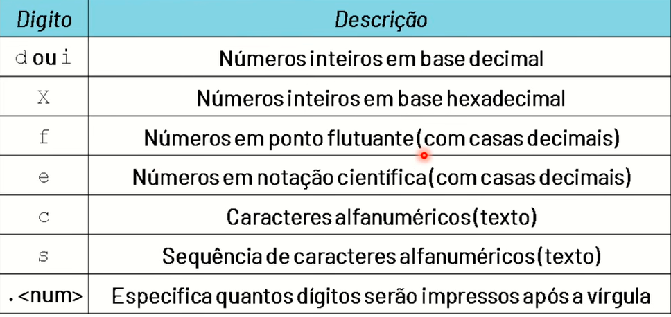
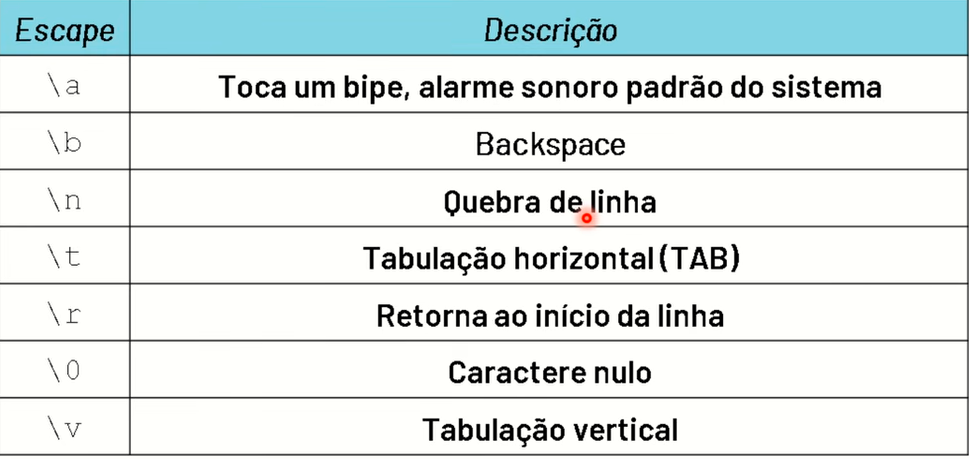
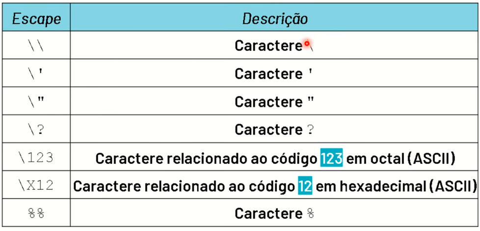

# Curso Logica De Programação Em C

 - Link: [PLAYLIST DO CURSO LOGICA DE PROGRAMACAO EM C](https://www.youtube.com/playlist?list=PLpaKFn4Q4GMOBAeqC1S5_Fna_Y5XaOQS2)

- 2.1 Saida De Dados - Sequencias de Escapes/
  

